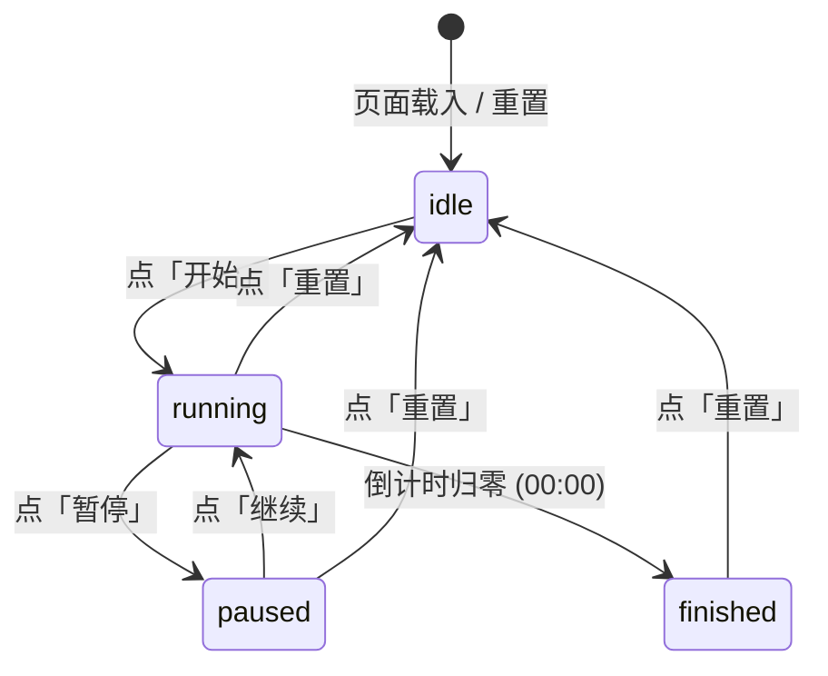

“帮我做一个番茄钟”足以让 Agent 生成几百行代码，但往往伴随各种多余设计：未经确认加了音效、弹窗通知、复杂的设置面板，或者刷新后状态错乱。

在五步循环中，第一步是想清楚：先不急着写代码，而是通过简短的提问，把实现细节和边界确认下来，整理为一份 `REQUIREMENT.md`，并作为第一次 Git 提交保存。

## 让 Agent 先提问

在已打开的 `pomodoro` 项目中，向 Agent 发送以下访谈提示词：

```text title="结构化访谈提示词"
我要做一个本地番茄钟网页，双击就能打开。
先不要写代码。最多问我 10 个会影响实现的问题，一次列完。
不要问配色和字体，问题按重要性排序。
```

下面是当时在 VS Code 中与 Agent 进行需求访谈的真实对话过程：

<PiChat />

## 需求卡包含哪几部分

写给 Agent 的需求文档不需要长篇大论，只要把下面这四点交代清楚即可：

1. **运行环境**：明确是单文件网页，在本地双击直接打开，不需要配置本地服务器或安装依赖。
2. **界面与输入输出**：页面上只有大号时间、主按钮、重置按钮和完成次数，没有其他复杂操作。
3. **状态切换规则**：理清倒计时在开始、暂停、继续和重置之间的流转方式，归零停在 00:00 并修改网页标题。
4. **明确不做的事（排除清单）**：提前声明不做音频、不做桌面通知、不做设置页，防止 Agent 自作主张添加多余功能。

## 整理需求文档：REQUIREMENT.md

根据上面的问答，Agent 在项目根目录生成了最简需求卡 [REQUIREMENT.md](file:///home/yoake/Code/pomodoro/REQUIREMENT.md)（仅 44 行，干净克制）：

```markdown title="REQUIREMENT.md"
# 番茄钟 Demo 需求（最简版）

教学演示用，拒绝过度设计。单文件 `index.html`，内联全部 CSS 与 JS，双击用 `file://` 直接打开即可使用，不依赖网络、构建或本地服务器。

## 范围

固定 25 分钟倒计时，无设置页，无休息倒计时，无音频，无桌面通知，无任务列表，无图表。

## 输入

| 操作 | 说明 |
| --- | --- |
| 点主按钮 | 25:00 静止时开始倒计时；计时中暂停；暂停后继续 |
| 点重置按钮 | 任意时刻回到 25:00 并停止计时 |
| 刷新页面 | 回到 25:00 静止态（不恢复进行中的计时） |

## 输出

- 大号时间：`25:00` 起，每秒递减，到 `00:00` 停住不再继续。
- 主按钮文案：`开始` / `暂停` / `继续`，与当前状态一致。
- 重置按钮：始终可用。
- 当前阶段：专注中 / 已结束（仅用于控制按钮与标题，不新增界面元素）。
- 今日完成数：计数文本显示在页面上，完成一次 +1。

## 状态

`idle`（25:00 静止）→ `running`（递减中）⇄ `paused`（暂停）→ `finished`（停在 00:00）。

- `idle` 点开始 → `running`。
- 主按钮点击 `idle` 变为 `开始`，`running` 变为 `暂停`，`paused` 变为 `继续`。
- `running` 或 `paused` 点重置 → `idle`。
- `running` 归零 → `finished`，网页标题改为「休息一下」，今日完成数 +1。
- `finished` 点重置 → `idle`，标题恢复，可再次计时。

## 数据

localStorage 仅存今日完成数（含日期），跨天自动归零；刷新页面不清除。计时进度不持久化。

## 验收标准

1. 双击 `index.html` 直接打开可用：无控制台报错、无外部请求，页面只包含大号时间、主按钮、重置按钮三项核心元素。
2. 点开始后时间从 25:00 逐秒递减到 00:00 并停住；期间按钮在 开始/暂停/继续 之间正确切换，重置任意时刻回到 25:00 且计时停止。
3. 归零时网页标题变为「休息一下」且今日完成数 +1；刷新页面回到 25:00 静止、标题恢复，同一天内完成数保留。
```

## 状态机流转图

用 Mermaid 把这四种状态画出来，逻辑一目了然：



## 首次提交：保存需求文档

需求确认无误后，让 Agent 在终端中将 `REQUIREMENT.md` 提交到 Git：

::: steps
1. **向 Agent 发送提交指令**
   让 Agent 在终端中执行 Git 暂存与提交：

   ```text title="提交提示词"
   这份 REQUIREMENT.md 很好。
   请调用终端命令，把 REQUIREMENT.md 暂存并提交，提交信息为 "docs: 建立番茄钟最简需求卡"。
   ```

2. **Agent 调用终端执行提交**
   Agent 收到指令后，在终端中执行命令完成首次提交：

   ```bash title="终端执行输出"
   💻 [Bash]:
   $ cd /home/yoake/Code/pomodoro && git add REQUIREMENT.md && git commit -m "docs: 建立番茄钟最简需求卡"

   📋 [Result]:
   [main（根提交） e629d7c] docs: 建立番茄钟最简需求卡
    1 file changed, 43 insertions(+)
    create mode 100644 REQUIREMENT.md
   ```
:::

::: tip 为什么需求也要进 Git
将需求文档作为独立提交保存，便于后续回顾和版本追溯，在修改代码或出现分歧时也有明确的对照依据。
:::

需求整理并提交后，下一步进入拆解计划阶段。点击下方「下一页」让 Agent 先交方案。
