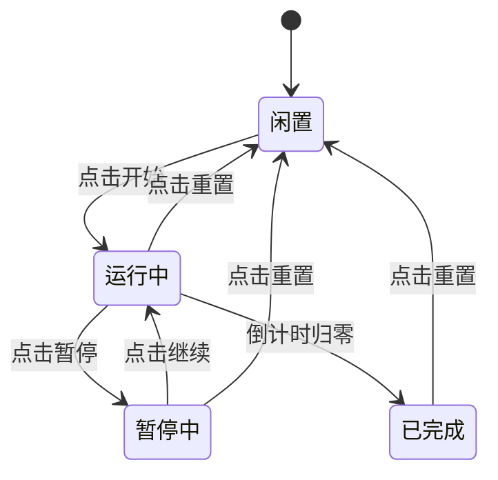

“帮我做一个番茄钟”足以让 Agent 开始生成，却没有说明你的具体要求。时长能否修改、刷新后保留什么、怎样算完成一次，都会改变实现方式。先做一次短访谈，再写需求卡。

## 让 Agent 先提问

在 `pomodoro` 项目里输入：

```text
我要做一个本地番茄钟网页，双击就能打开。
先不要写代码。最多问我 10 个会影响实现的问题，一次列完。
不要问配色和字体，问题按重要性排序。
```

下面是一组示例问答。你的 Agent 可能问得不同，重点是把会影响行为的分支决定下来。

:::: chat title="需求访谈"

{Agent}

1. 固定 25 分钟，还是允许修改？
2. 怎样才算完成一个番茄，重置算不算？
3. 归零后自动休息，还是停下等待操作？
4. 关闭或刷新页面后，倒计时继续还是重置？
5. 今日完成数要保留吗，跨天怎样处理？
6. 归零时用声音还是视觉提示？
7. 手机也要使用吗？
8. 需要暂停和继续吗？
9. 初始与归零分别显示什么？
10. 使用单文件还是拆分文件？

{.}

1. 固定 25 分钟，不做设置页。
2. 自然归零才算，重置不算。
3. 停在 00:00，下一次点击开始才重新计时。
4. 刷新和重新打开都回到 25:00，只保留今日完成数。
5. 按本地日期保存，新的一天从 0 开始。
6. 不做声音，归零时把标题改成「休息一下」。
7. 手机能看清、按钮不重叠即可。
8. 需要暂停和继续。
9. 初始 25:00，归零 00:00。
10. 单个 index.html，双击运行。

::::

## 需求卡的五个结构要素

写给 Agent 的需求文档不需要长篇大论，但必须包含以下五个字段：

:::: field-group

::: field scene
@type string
@required
使用者与具体使用环境。例如笔记本自习或移动端展示。
:::

::: field io
@type string
@required
用户可进行的操作输入，以及页面呈现给用户的全部视觉输出。
:::

::: field rules
@type string[]
@required
核心逻辑与状态流转规则，明确不同操作下的具体行为变化。
:::

::: field constraints
@type string[]
@required
运行环境与实现边界。例如单文件运行、无外部依赖、响应式宽度限制。
:::

::: field out-of-scope
@type string[]
@required
本版明确排除的功能，防止 Agent 在实现过程中自行发散。
:::

::::

## 把决定写进 REQUIREMENT.md

在项目根目录新建 `REQUIREMENT.md`，粘贴下面的内容：

```markdown
# 番茄钟需求卡

## 使用者与场景
我自己在宿舍用笔记本自习，每天使用 2–4 次，也要能在手机浏览器里看清。

## 输入
点击开始/暂停/继续和重置，没有文字或文件输入。

## 输出
- 大数字显示剩余时间，初始为 25:00
- 浏览器标题同步显示剩余时间
- 显示今日完成数
- 归零后显示 00:00，标题变成「休息一下」

## 功能规则
- 开始后按真实经过的时间倒计时
- 暂停后数字不变，继续后从暂停处走
- 重置回到 25:00，不增加完成数
- 只有自然归零才计为完成，一次归零只能加 1
- 归零后停留在 00:00，再次开始才进入完整 25 分钟
- 刷新或重新打开后，倒计时回到 25:00
- 今日完成数保存在当前浏览器，按本地日期从 0 开始

## 约束
- 单个 index.html，双击打开，无外部依赖
- 不请求外部 API，数据只存当前浏览器
- 375px 宽度下数字和按钮不重叠、不溢出

## 本版不做
登录、云同步、自定义时长、休息倒计时、任务清单、统计图表、声音和系统通知。
```

## 状态转移与交互规则

番茄钟在运行周期内只有四种状态。把状态和操作画清楚，后续编写代码和验收时就能直接对照：



每个状态下的按钮可用性如下表所示：

| 页面状态 | 主按钮文字 | 主按钮是否可用 | 重置按钮是否可用 |
| --- | --- | --- | --- |
| **闲置** | 开始 | 可用 | 禁用 |
| **运行中** | 暂停 | 可用 | 可用 |
| **暂停中** | 继续 | 可用 | 可用 |
| **已完成** | 开始 | 禁用 | 可用 |

## 验收标准

| # | 操作 | 预期结果 |
| --- | --- | --- |
| 1 | 首次打开页面 | 显示 `25:00`，标题同步，主按钮为「开始」 |
| 2 | 开始、等待 5 秒、暂停、继续 | 约减少 5 秒；暂停时不动；继续后从原位置走 |
| 3 | 连续点击主按钮，再分别测试运行中和暂停后的重置 | 状态按开始/暂停/继续切换，速度不变；重置回 25:00 且不计数 |
| 4 | 临时把 `TOTAL` 改成 `3`，等待归零，再次开始 | 显示 `00:00` 和「休息一下」，今日数只加 1；再次开始回到完整测试时长 |
| 5 | 完成一次后刷新并重新打开 | 倒计时回 25:00，今日数保留 |
| 6 | 运行时切到另一个标签页 30 秒再回来 | 剩余时间约减少 30 秒，允许约 1 秒显示误差 |
| 7 | 把测试存储日期改成昨天，再重新打开 | 今日数从 0 开始；测试后清理测试数据 |
| 8 | 开发者工具切换到 375px 视口 | 数字、按钮和文字不重叠，页面无意外横向滚动 |

第 4 条结束后把 `TOTAL` 恢复为 `25 * 60`。第 7 条可以在 Console 中修改本项目的存储对象，也可以让 Agent 告诉你怎样只修改测试数据；不要更改其他网站的存储。

## 三个实现决定

### 为什么不用框架

这个案例要求单文件、双击运行、无构建步骤，原生 HTML / CSS / JavaScript 已经足够。框架并非一定需要 npm 或构建，但本版没有必要为此增加学习成本。
### 为什么使用 localStorage

只需要在当前浏览器保存一个很小的每日计数，`localStorage` 调用简单，能满足需求。IndexedDB 等方案也不需要后端，但对这个案例更复杂。

存储对象时写入用 `JSON.stringify`，读取用 `JSON.parse`，还要处理空值、损坏数据和存储不可用。
### 为什么用时间戳计算

初版可以先按每秒减 1 的方式实现，再通过后台标签页测试发现问题。修复时记录目标结束时间，用 `endAt - Date.now()` 计算剩余时间。

这是调试阶段要练习的实现决策，不提前声称第一版已经采用。
需求卡保存后，进入 [让 Agent 先交方案](/case-timer/prompt/)。
