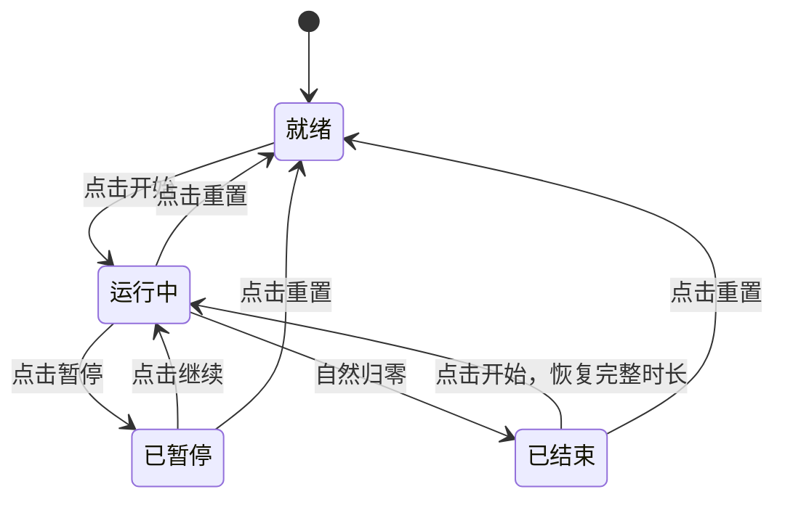

按照 `TODO.md` 执行，每条任务都经过指令、diff、运行和验收。示例代码用于展示常见问题，你的 Agent 输出不必与它逐行相同。

## 第 1 条：静态骨架

```text
做 TODO.md 第 1 条：一个 index.html，居中显示 25:00，
下面放开始和重置按钮，再显示今日完成数。
样式写在 <style> 里，按钮暂时不需要功能。
```

打开页面，检查数字、两个按钮和计数是否完整，375px 宽度下是否溢出。视觉调整要给出具体值，例如“数字改为 72px，按钮间距 12px”，不要只说“更高级一点”。

确认后提交：

```bash
git add .
git commit -m "添加番茄钟静态骨架"
```

## 第 2、3 条：计时与按钮状态

这两条可以合并为一个紧密相关的小迭代：

```text
做 TODO.md 第 2、3 条。
实现 MM:SS 渲染、开始、暂停、继续和重置，按钮文字随状态变化。
只改 index.html，不实现今日计数，不增加其他功能。
```

Agent 可能给出类似下面的简化版本。它能计时，却没有完整满足指令，正好用来练习验收。

::::: demo title="错误版 · 能计时但未通过验收" desc="连续点击开始会加速，重置也没有停止旧定时器。此示例仅用于观察问题。"
```html
<div class="pomo">
  <div id="clock">25:00</div>
  <div class="btns">
    <button id="toggle">开始</button>
    <button id="reset">重置</button>
  </div>
</div>
<style>
  body {
    margin: 0;
    min-height: 240px;
    display: grid;
    place-items: center;
    font-family: system-ui, sans-serif;
    background: #0f1115;
    color: #e8ecf3;
  }
  #clock { font-size: 56px; font-variant-numeric: tabular-nums; }
  .btns { display: flex; gap: 10px; margin-top: 16px; }
  button { padding: 9px 20px; font-size: 15px; }
</style>
<script>
  const clock = document.querySelector('#clock')
  let remain = 25 * 60
  let timerId = null

  function render() {
    const m = String(Math.floor(remain / 60)).padStart(2, '0')
    const s = String(remain % 60).padStart(2, '0')
    clock.textContent = m + ':' + s
  }

  document.querySelector('#toggle').addEventListener('click', () => {
    timerId = setInterval(() => {
      remain--
      render()
    }, 1000)
  })

  document.querySelector('#reset').addEventListener('click', () => {
    remain = 25 * 60
    render()
  })

  render()
</script>
```
:::::

可以观察到四个问题：重复点击会创建多个定时器；主按钮没有暂停功能；重置没有停止旧定时器；归零后还会继续减成负数。它还完全没有实现归零提示和今日计数，因此不能宣称任务全部完成。

重复启动不需要拼手速。只要第一个定时器仍在运行，之后再次点击就会再创建一个。

## 画出来：按钮怎样切换状态

只盯着按钮文字容易漏掉行为。先把程序分成四种状态，再沿箭头操作一遍：



“运行中”和“已暂停”可能显示相同的时间，但下一秒的行为不同。程序必须保存状态，不能只看页面上是不是写着 `24:59`。

:::: steps

1. **开始，再暂停**

   等待 3 秒，记住数字；暂停后再等 3 秒，数字应保持不变。

2. **继续，再重置**

   继续后应从暂停处减少；运行中重置应回到 `25:00`，并停止变化。

3. **在暂停时重置**

   重复第一步，再点重置。主按钮应变回“开始”，不能仍然写着“继续”。

::::

归零分支留到后面的短时长测试。如果某条箭头走不通，把操作顺序写进问题报告，不要只说“按钮不正常”。

## 提交前看 diff

| 检查 | 这个版本怎样判断 |
| --- | --- |
| 修改范围 | 是否只改了 `index.html`，有没有无关文件 |
| 需求覆盖 | 暂停、继续、重置和按钮文字是否真的实现 |
| 状态处理 | 启动前是否检查旧定时器，重置是否同时处理状态和界面 |
| 额外内容 | 是否出现需求之外的依赖、主题或音效 |

`+38 −2` 之类的行数只是本次输出规模，不是“合格”的依据。即使行数很少，漏掉暂停也一样不能通过。

如果要保留这个调试起点，可以做一次明确标记的 WIP 提交：

```bash
git add index.html
git commit -m "WIP：保存待调试的计时版本"
```

它表示尚未验收，不要写成“完成开始与暂停”。

## 读代码时先看三处

**状态变量**

```js
let remain = 25 * 60
let timerId = null
```

`remain` 保存剩余秒数，`timerId` 保存定时器句柄。页面上的文字由 `remain` 计算得出，修改字符串本身不会更新程序状态。

**渲染函数**

```js
function render() {
  const m = String(Math.floor(remain / 60)).padStart(2, '0')
  const s = String(remain % 60).padStart(2, '0')
  clock.textContent = m + ':' + s
}
```

`Math.floor(remain / 60)` 计算分钟，`remain % 60` 取剩余秒数，`padStart(2, '0')` 补成两位。显示格式不正确时，可以先检查这里。

**定时逻辑**

```js
setInterval(() => {
  remain--
  render()
}, 1000)
```

这段代码假设每次回调都恰好过去一秒，并且每次点击只需要一个新定时器。后面的重复启动和后台计时不准都与这两个假设有关；存储问题则要到数据读写部分检查。

[下一步：逐项调试](/case-timer/bug/){.read-more}
