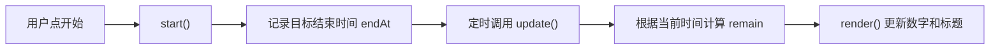

Simon Willison 提出过一条值得借鉴的原则：不能向别人准确解释的代码，不应直接提交到自己的仓库。初学者不必立刻读懂每一行，但至少要知道文件职责、关键数据怎样变化，以及哪些边界尚未处理。

## 三遍阅读法

### 第一遍：看结构

先读文件名、入口和函数名，暂时不深入实现：

```text
index.html    页面结构与脚本入口
data.js       课程数据
app.js        校验、计算和渲染
  ├─ validCourse()   检查字段和范围
  ├─ buildColumns()  计算表格位置
  └─ render()        根据位置更新页面
```

这一遍的产出可以是一张很短的文件职责表。说不清某个文件为什么存在，就先问清楚，不要继续堆新功能。

### 第二遍：追踪一条数据流

以番茄钟为例：



`endAt` 让剩余时间根据真实时间计算。后台标签页的回调仍可能变慢，只是返回页面后会重新算出当前剩余时间，不能写成切到后台后更新频率完全不变。

这张图只覆盖计时状态，不能据此判断刷新后哪些数据保留。还要继续搜索 `localStorage`、初始化读取和保存调用，分别追踪今日计数和周次设置。

### 第三遍：列边界

检查空输入、超长输入、重复点击、归零、越界、存储失败和脚本加载顺序。没有处理的情况不一定都是 bug，有些可能是明确不支持的限制；无论哪种，都应写进测试清单或 README。

三遍结束，你应得到一份文件职责表、一条核心数据流和一张边界清单。

## 让 Agent 帮你解释

```text
停止修改代码。
按文件职责、核心数据流和边界处理三部分解释当前实现。
每部分引用需要阅读的代码位置，不要逐行复述。
最后出 3 个问题考我，等我回答后再给答案。
```

Agent 的解释也是辅助材料。它给出的行号、调用关系和原因要回到源码核对。

时间很少时，可以先问“哪三行是理解这段逻辑的入口”，再沿变量赋值、函数调用和使用位置继续读。关键逻辑往往不止三行，三行只是起点。

## 一个小练习

```js
const state = { count: 0 }

function render() {
  document.querySelector('#out').textContent = state.count
}

document.querySelector('#add').addEventListener('click', () => {
  let count = state.count + 1
  render()
})

render()
```

<Quiz
  q="为什么点了「加一」按钮，屏幕上的数字不变？"
  a="render() 没有被调用"
  b="回调里改的是局部变量 count，state.count 从来没变过"
  c="querySelector 找不到 #out 这个元素"
  d="addEventListener 只能绑定一次点击"
  correct="b"
  why="let count = state.count + 1 只在回调内部创建临时变量。render() 读取的是 state.count，它仍然是 0。应更新 state.count 后再调用 render()。"
/>

## 注释应该写什么

逐行复述代码的注释通常没有帮助：

```js
// count 加一
count++
```

解释外部约束或非显而易见原因的注释值得保留：

```js
// 第 1 周按单周计算；week 始终从 1 开始
if (course.weeks === 'odd') return week % 2 === 1
```

不要要求 Agent“给每行加注释”，可以问“哪些地方需要说明原因，哪些地方只是复述代码”。

## 自测

尝试向同学讲清一个核心操作从输入到显示的过程。再设想一个小改动，例如“暂停时按钮变灰”，说出需要修改的文件、状态和相关验收。讲不清的部分就是下一轮阅读重点。

读懂关键结构后，继续看 [写测试](/craft/test/)，把可自动检查的行为固定下来。
