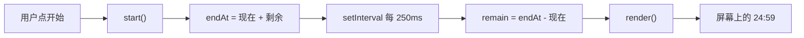

Simon Willison 有一条被引用最多的规矩：

> 如果我不能向别人准确解释这段代码在干什么，我不会把它提交到我的仓库里。

这句话不是道德要求，是止损线。你提交了一个自己解释不了的东西，下一次改它的时候，你只能再求一次 AI。**两次之后，这个项目就不是你的了。**

## 你不需要读懂每一行

需要的是三件事，按重要性排：

1. **每个文件在干什么**（一句话）
2. **数据怎么流动**（从哪来，存哪，怎么变成屏幕上的东西）
3. **哪里最可能坏**（边界情况怎么处理）

这三件事读懂了，你就拥有了这个项目。剩下的细节，用到的时候再查。

## 三遍法

### 第一遍：结构，两分钟

只看文件名和函数名，不看实现。

```text
index.html    → 结构
style.css     → 样式
script.js     → 逻辑
  ├─ state    → 存什么
  ├─ render() → 把 state 画到屏幕上
  ├─ start()  → 开始计时
  └─ reset()  → 归零
```

读完这一遍，你应该能说出：**入口是哪个文件、有哪几个函数、分别干什么。**

### 第二遍：数据流，五分钟

追踪一个变量从生到死：



看懂这张图，你就知道了：刷新页面会丢什么、暂停要改哪里、为什么切标签页不会变慢。

### 第三遍：边界，五分钟

专门看"不正常的情况"怎么处理：

- 空输入、超长输入
- 重复点击
- 失败（网络断了、数据不存在）
- 归零、越界、负数

如果代码里**根本没有处理**，那不是"没问题"，那是"还没被发现的问题"。记下来，这就是你的测试清单。

## 让它讲给你听

最有效的指令，一字不改就能用：

```text
功能可以了，现在停下来，不要再改任何东西。

用大白话逐段解释你刚才写的东西：每段先贴出代码，
再用一两句话讲它在干什么、为什么这么写。
就像讲给一个只学过 C 语言的大一学生听。

解释完出 3 个问题考我，我答完你再公布答案。
我答错了，就换一种方式再讲一遍。
```

最后那句"考我"是关键。听懂了和能答对，是两件事。

## 只问三行

如果你只有一分钟：

```text
这个文件里，哪三行是最关键的？只给我行号和一句话解释。
```

只要三行。看懂那三行，剩下的通常是包装。这个方法在别人的代码、教程里的示例、面试题上都好用。

## 试一下

看这段代码。它想做一个计数器，但点了按钮数字不变。

```js
const state = { count: 0 }

function render() {
  document.querySelector('#out').textContent = state.count
}

document.querySelector('#add').addEventListener('click', () => {
  let count = state.count + 1
  render()
})

render()
```

<Quiz
  q="为什么点了「加一」按钮，屏幕上的数字不变？"
  a="render() 没有被调用"
  b="回调里改的是局部变量 count，state.count 从来没变过"
  c="querySelector 找不到 #out 这个元素"
  d="addEventListener 只能绑定一次点击"
  correct="b"
  why="第 9 行 let count = state.count + 1 只是在回调内部创建了一个临时变量，函数一结束它就没了。render() 读的永远是 state.count，而它一直是 0。正确写法是 state.count += 1 再 render()。"
/>

能自己找出这一行，比你写一百行新代码有价值。**这类 bug 是 AI 最常犯的**——它知道要更新界面，但忘了更新真正的那个状态。

## 自测两招

**一、向室友复述。** 用三句话讲清这个项目怎么运作。讲不清的地方，就是你还没懂的地方。

**二、断网测试。** 关掉 AI，问自己：如果现在要加一个"暂停时按钮变灰"的功能，我知道该改哪个文件的哪一段吗？

- 知道 → 这个项目是你的
- 不知道 → 你只是租了它

## 别让它加注释

"帮我加满注释"是最没用的指令之一。你会得到：

```js
// 定义变量 count
let count = 0
// 给按钮添加点击事件
btn.addEventListener('click', () => {
  // count 加一
  count++
})
```

这不会让你看懂任何东西，只会让你以为看懂了。

换成这两个：

```text
这段代码里，哪一部分最容易出错？为什么？
```

```text
如果我要把计时从 25 分钟改成可配置的，需要动哪几个地方？
```

第二个问题特别好用：**它逼你理解结构**，而不只是理解语法。

## 接管的那一刻

迟早会有一次：AI 改了三轮都没改对，你已经知道问题在哪了。

这时候**自己上手改那两行**。不用问它，不用描述，直接改，改完跑一遍。

那一刻你才真的在写代码——不是"让 AI 写代码"，是你写。它只是你的打字员。

::: tip 下一步
读懂了，怎么证明它真的对？[写测试](/craft/test/)——让命令替你把关，而不是靠感觉。
:::
