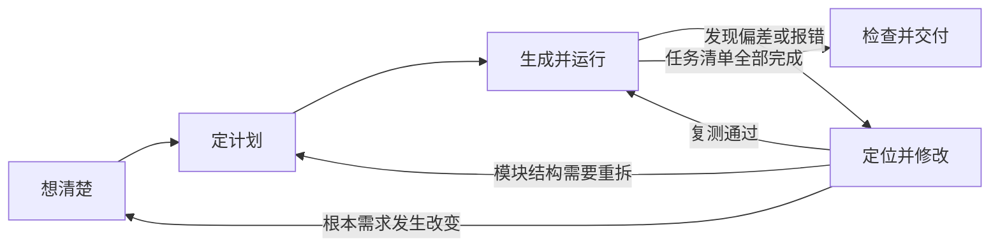

Vibe Coding 也需要明确的工作步骤。这份指南把一次开发分成五步：想清楚、定计划、生成并运行、发现问题并修改、检查并交付。每一步都有可以检查的产出，方便你知道当前进展，也方便在出错时回到上一步。

## 一圈长什么样

<FiveLoop />

## 五步标准产出

::: steps{title="五步执行标准与交付物"}

1. **想清楚：写定需求卡**
   确定使用对象、输入、输出、边界和本版不做的事项。
   - 交付物：一份 `REQUIREMENT.md` 文件。
   - 完成标志：每条核心需求都配有明确的手动验证操作。

2. **定计划：划分文件与拆解任务**
   让 Agent 读取需求卡，先给出文件清单、依赖关系和实现顺序，不要直接写代码。
   - 交付物：一份包含顺序项的 `TODO.md` 任务清单。
   - 完成标志：每项任务粒度可在一小时内完成，且能单独运行检验。

3. **生成并运行：单任务推进**
   一次只派发一项具体任务，生成后先看 diff，确认没有越权修改其他文件，立刻在本地运行。
   - 交付物：包含单一修改的运行版本与一次 Git 提交。
   - 完成标志：在界面上看到了实际运行结果，且清楚修改了哪些代码行。

4. **定位并修改：复现与复测**
   出现报错或行为偏差时，先整理稳定复现步骤，再让 Agent 给出修复方案。
   - 交付物：修复后的代码与原因记录。
   - 完成标志：复现操作不再报错，同时原有相关功能通过回归测试。

5. **检查并交付：跨环境验证**
   脱离当前开发环境，按说明文件重新走一遍完整流程。
   - 交付物：完备的 `README.md` 与最终可运行产物。
   - 完成标志：在无痕窗口或全新目录下能够直接按说明启动并正常使用。

:::

## 跳步后常见的问题

:::: collapse

### 没写清需求，功能越来越多

你让 Agent 做一个记账页面，完成后才想起要按周统计，随后又要导入账单。做到第三天才发现真正需要的是和室友共享数据，单机版的数据方案就无法满足需求。

需求可以调整，但要把变化和原因写下来，同时更新验收标准。只靠对话里临时补充，很容易让不同功能按照互相冲突的假设实现。

### 没看计划，一次生成太多代码

Agent 一次给出几百行代码，页面可能确实能运行。但如果你不知道文件职责和数据流，后续每次修改都很难判断影响范围，也无法确认它有没有顺带改动已有功能。

先审计划，再按任务生成，可以把审查工作分散到每一小步。

### 没做交付检查，换台电脑就失败

本机运行时，你可能依赖了只有自己电脑上存在的路径、软件或配置。作业发到另一台电脑后，资源路径、依赖版本和启动命令的问题才会暴露。

交付前要按 README 从头操作一次，并检查密钥、隐私数据和已知限制。

::::

## 任务拆到多大合适

一个小功能迭代可以控制在 30–60 分钟内，但这只是参考，不是超时判定。更重要的是，每条任务应有明确结果，并能在一组简短操作后判断对错。

diff 行数只能用来提醒你看慢一些。几行改动也可能删除关键逻辑，首次搭建骨架产生较多新增行也很正常。审查时重点看行为变化、涉及文件、依赖和测试，不要只按行数决定接受或拒绝。

一次只处理一个目标。修 bug 时顺便加功能，会让你难以判断复测通过究竟说明什么。

## 卡顿时回到哪一步

:::: flex around center gap="16"

<Card title="需求说法一直变化" icon="carbon:chat">

回到「想清楚」，把当前需求、排除项和验收标准写进文件。后续讨论以这份文件为准。

</Card>

<Card title="Agent 想重写整个文件" icon="carbon:warning-alt">

回到「定计划」，检查任务是否太大、文件职责是否混杂，以及当前上下文是否缺少关键约束。

</Card>

<Card title="你不敢运行" icon="carbon:play">

先判断原因。任务太大就继续拆分；担心删除文件、付费 API 或部署副作用，就先备份、限制权限，并使用测试环境。

</Card>

::::

## 这一章怎么读

先读「想清楚」，然后进入 [案例一](/case-timer/) 动手。生成、调试或交付时遇到具体问题，再回来读对应一节。每节都有示例和可复制模板，但模板要按项目实际内容修改。

如果环境还没准备好，请从 [安装 VS Code](/start/vscode/) 开始。
