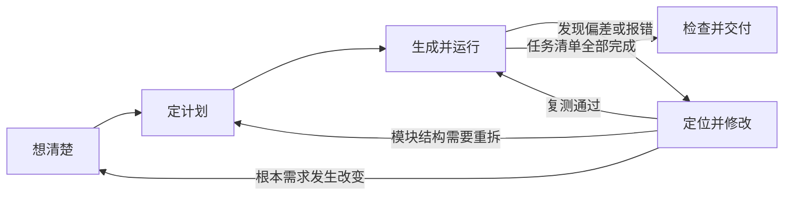

Vibe Coding 也需要明确的工作步骤。这份指南把一次开发分成五步：想清楚、定计划、生成并运行、定位并修改、检查并交付。每一步都有可以检查的产出，方便你知道当前进展，也方便在出错时回到上一步。

## 一圈长什么样

开发过程通过这五个阶段流转，并根据每个阶段的验证反馈决定继续推进还是回退：

- **顺序推进**：从需求卡出发，拆解计划后逐项推进，所有清单项完成后进行交付检查。
- **遇到问题即时排查**：运行出现报错或界面偏差时，先在本地稳定复现并修复，复测通过后再继续推进。
- **根据反馈及时回退**：调试时若发现需求本身存在遗漏或矛盾，回到「想清楚」更新需求文档；若发现文件职责不清或任务拆解过大，回到「定计划」重新划分。

## 五步标准产出

::: steps

1. **[想清楚](/loop/think/)：写定需求卡**
   明确使用对象、输入、输出、边界和本版不做的事项。在让 Agent 生成代码前，先把需求写成独立文档。
   - 交付物：一份 `REQUIREMENT.md` 文件。
   - 完成标志：每条核心需求都配有明确的手动验证操作。

2. **[定计划](/loop/plan/)：划分文件与拆解任务**
   让 Agent 读取需求卡，先给出文件清单、依赖关系和实现顺序，不要直接写代码。
   - 交付物：一份包含顺序项的 `TODO.md` 任务清单。
   - 完成标志：每项任务粒度可在一小时内完成，且能单独运行检验。

3. **[生成并运行](/loop/build/)：单任务推进**
   一次只派发一项具体任务，生成后先检查代码改动，确认没有越权修改其他文件，立刻在本地运行。
   - 交付物：包含单一修改的运行版本与一次 Git 提交。
   - 完成标志：在界面上看到了实际运行结果，且清楚修改了哪些代码行。

4. **[定位并修改](/loop/fix/)：复现与复测**
   出现报错或行为偏差时，先整理稳定复现步骤，再让 Agent 给出修复方案。
   - 交付物：修复后的代码与原因记录。
   - 完成标志：复现操作不再报错，同时原有相关功能通过回归测试。

5. **[检查并交付](/loop/ship/)：跨环境验证**
   脱离当前开发环境，按说明文件重新走一遍完整流程。
   - 交付物：完备的 `README.md` 与最终可运行产物。
   - 完成标志：在无痕窗口或全新目录下能够直接按说明启动并正常使用。

:::

## 跳步后常见的问题

::: collapse accordion
- :+ 没写清需求，功能越做越多

  做记账页面时，如果先没定好范围，做完单机版才想起要按周统计，随后又要导入账单，甚至做到第三天才发现需要与室友共享数据，单机方案就会全盘推翻。需求可以调整，但要把变化和原因写进需求卡，同时更新验收标准，不能只靠对话里临时补充。

- 没看计划，一次生成过多代码

  Agent 一次给出数百行代码时，哪怕页面看似能跑，但由于不知道文件职责和数据流，后续每次修改都很难判断影响范围，也无法确认是否破坏了已有功能。坚持先审计划再分步生成，能把审查工作分散到每一个可控的小步。

- 缺少交付检查，换台电脑无法运行

  在本机运行时，环境可能隐式依赖了只有当前电脑才有的本地路径、系统全局工具或环境变量。作业换到另一台设备后，资源路径缺失、依赖未记录等问题就会集中暴露。交付前必须按说明在全新目录下重新走一遍安装运行流程。
:::

## 任务拆到多大合适

一个小功能迭代可以控制在 30–60 分钟内，但这只是参考，不是超时判定。更重要的是，每条任务应有明确结果，并能在一组简短操作后判断对错。

改动行数只能用来提醒你看慢一些。几行改动也可能删除关键逻辑，首次搭建骨架产生较多新增行也很正常。审查时重点看行为变化、涉及文件、依赖和测试，不要只按行数决定接受或拒绝。

一次只处理一个目标。修 bug 时顺便加功能，会让你难以判断复测通过究竟说明什么。

## 卡顿时回到哪一步

:::: card-grid cols="3"

<Card title="需求说法一直变化" icon="carbon:chat">

回到「想清楚」，把当前需求、排除项和验收标准写进文件。后续讨论以这份文件为准。

</Card>

<Card title="Agent 想重写整个文件" icon="carbon:warning-alt">

回到「定计划」，检查任务是否太大、文件职责是否混杂，以及当前上下文是否缺少关键约束。

</Card>

<Card title="你不敢运行" icon="carbon:play">

先判断原因。任务太大就继续拆分；担心删除文件、付费 API 或部署副作用，就先备份、限制权限，并使用测试环境。

</Card>

::::

## 这一章怎么读

先读「想清楚」，然后进入 [案例一](/case-timer/) 动手。生成、调试或交付时遇到具体问题，再回来读对应一节。每节都有示例和可复制模板，但模板要按项目实际内容修改。

如果环境还没准备好，请从 [安装 VS Code](/start/vscode/) 开始。
