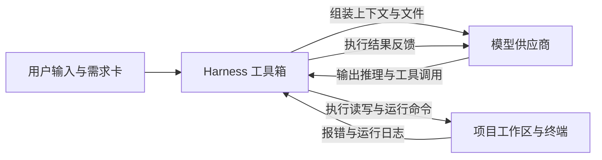

工具可以换，需求、审阅和验收的方法可以保留。先按自己的网络、费用和认证条件选一种，能实际读写项目文件即可，不必同时安装好几种。

## 编程 Agent 多了哪些能力

下面比较的是未连接项目的纯聊天页面和编程 Agent。网页产品如果提供文件上传、代码执行或 Agent 功能，也可能具备其中一些能力。

| | 未连接项目的聊天页面 | 编程 Agent |
| --- | --- | --- |
| 获取项目代码 | 通常由你复制粘贴 | 可以通过工具读取获准访问的文件 |
| 修改项目 | 通常由你复制回编辑器 | 可以在授权后修改文件 |
| 运行命令 | 取决于产品功能 | 可以安装依赖、运行测试并读取报错 |
| 出错后的处理 | 你补充报错和上下文 | 可以根据工具输出继续排查 |

## 编程 Agent 的底层机制

各家编程 Agent 的界面、侧边栏和快捷键各有不同，但底层架构基本一致：



本质上，它由三部分组成：

1. **ReAct 循环**：模型在推理分析与采取行动之间交替。根据给定的代码和报错信息，决定下一步是读文件、改代码还是在终端执行测试。
2. **Harness 环境**：负责实际的文件搜索、文件读写、命令执行与权限拦截，并把执行结果回传给模型。
3. **模型供应商**：后端提供文本与代码生成能力的大模型。

Agent 只是执行任务的工具。工具随时可以替换，核心能力始终在于：想清楚需求、设计验收标准、把控任务粒度并仔细审阅代码 Diff。

## 三条路线，按你的条件选

:::: card-grid cols="3"

<Card title="路线一 · VS Code + Pi 插件" icon="carbon:terminal">

**VS Code + Pi 侧边栏插件**

通过侧边栏直接配置模型供应商，在编辑器内实时查看文件修改 Diff。

**适合**：本教程的主线配置。掌握模型供应商接入与侧边栏协作后，切换到其他同类 Agent 完全通用。

</Card>

<Card title="路线二 · 学生认证生态" icon="carbon:education">

**GitHub Copilot**

符合条件的学生可申请 GitHub Education 权益。是否包含 Copilot 及其额度以申请时的官方说明为准。

**适合**：已有或愿意申请 GitHub 学生认证。

</Card>

<Card title="路线三 · 国内服务与 Harness" icon="carbon:checkmark-outline">

**ZCode / WorkBuddy / Trae / DeepSeek Harness 等**

国内账号体系与网络环境下直接可用，或使用专门接入 DeepSeek 模型的 Harness 工具。

**适合**：希望使用国内网络服务，不想配置复杂的海外支付方式或终端环境。

</Card>

::::

三条路线都能完成本指南。界面形态可能不同，但“先给计划，等我确认后再改代码”的协作方式完全相同。

## 路线一：VS Code + Pi 侧边栏插件

教学统一以 VS Code 配合 Pi 侧边栏扩展为主线。Pi 负责充当 Harness 运行环境，你只需要填入自己的模型供应商 API 即可驱动它操作项目。

::::: steps

1. **安装 Pi 扩展**

   在 VS Code 中按快捷键 `Ctrl+Shift+X`（macOS 为 `Cmd+Shift+X`）打开扩展面板，在搜索框中输入 `Pi`，找到扩展后点击 **Install**。安装完成后，VS Code 最左侧的活动栏会出现 Pi 的图标。

2. **配置模型供应商**

   点击左侧活动栏的 Pi 图标展开侧边栏，点击右上角齿轮图标打开设置页。配置项分为以下四个核心参数：

   :::: field-group

   ::: field provider
   @type string
   @required
   选择服务商类型。支持主流服务商（如 DeepSeek、SiliconFlow、OpenAI、Anthropic）或选择 `Custom OpenAI-compatible` 接入任意兼容接口。
   :::

   ::: field base_url
   @type string
   @required
   模型供应商的 API 请求基准地址。官方直连通常使用默认地址；如果使用中转、代理或国内聚合服务商，必须完整填写接口地址（例如 `https://api.siliconflow.cn/v1` 或 `https://api.deepseek.com/v1`）。末尾注意不要漏掉版本号后缀。
   :::

   ::: field api_key
   @type string
   @required
   在对应服务商控制台生成的密钥令牌。密钥仅保存在你本地的 VS Code 配置中，切勿将密钥写入项目源码或提交到公开仓库。
   :::

   ::: field model_name
   @type string
   @required
   填入调用的模型具体标识符。例如 `deepseek-chat`、`deepseek-reasoner`、`claude-3-7-sonnet` 等。
   :::

   ::::

3. **在 VS Code 中打开项目根目录**

   在终端进入目标项目文件夹（如 `pomodoro`），运行 `code .` 打开编辑器。确保 VS Code 资源管理器中显示的是当前项目的具体目录，Pi 才能正确将当前文件夹作为上下文基准。

4. **确认工作模式与文件权限**

   在 Pi 侧边栏的输入框下方检查当前模式：
   - 确保当前处于 **Agent 模式**，具备读写文件与运行命令的权限，而非仅能对话的纯 Chat 模式。
   - 首次执行文件写入时，留意编辑器弹出的权限确认提示，点击允许修改。

5. **执行最小连通性测试**

   在侧边栏输入第一条测试指令，验证模型响应与本地文件读写链路是否通畅：

   ```text title="最小连通性测试提示词"
   在当前项目根目录下新建 hello.html，里面只有一行 <h1>Agent 连接成功</h1>。
   不要修改其他文件。
   ```

   发送后观察 Pi 是否正确调用了文件创建工具。检查左侧文件树中是否真实出现了 `hello.html`，用浏览器打开确认能正常看到页面标题。

6. **审阅 Diff 与接受修改**

   当 Agent 修改已有文件时，VS Code 会在编辑器中高亮显示绿色新增行与红色删除行。先逐行查看 Diff，确认改动完全符合你的要求后，再点击侧边栏的 **Accept** 确认落地，最后执行一次 Git commit。

:::::

::: tip 备选终端与侧边栏工具
如果你更习惯在终端操作，也可以选用 Claude Code、Codex CLI 或 OpenCode。它们与 Pi 一样都是 Harness 工具，底层的模型调用与上下文组装原理完全相同。
:::

:::: warning 控制按量计费的成本
使用商业 API key 时，务必在服务商后台设置单月预算和额度预警，避免 Agent 进入死循环产生非预期扣费。长任务完成后在侧边栏开启新会话，避免单次对话历史过长导致上下文 Token 消耗倍增。
::::

## 路线二：GitHub Copilot

::::: steps

1. 前往 GitHub Education 页面申请学生权益。具体所需材料以官方审核要求为准。
2. 认证通过后，在 GitHub 账号设置中确认 Copilot 权益已激活。
3. 在 VS Code 扩展市场搜索并安装 GitHub Copilot 扩展，登录对应账号。
4. 打开 Copilot Chat 侧边栏，将运行模式切换到 Agent 模式，执行最小测试验证文件修改能力。

:::::

学生权益范围可能调整。遇到额度或权限报错时，先核对个人账号后台的订阅状态。

## 路线三：国内开箱即用编程 Agent

国内有多款开箱即用的编程 Agent 产品与专用 Harness 工具可供选择：

- **ZCode**：国内大模型支持的编程辅助工具，对中文需求与本地环境支持良好。
- **WorkBuddy**：腾讯推出的 AI 编码伙伴（早期曾用名 CodeBuddy），提供编辑器插件与对话能力。
- **Trae**：字节跳动推出的编程环境，包含独立 IDE 与 Agent 模式。
- **DeepSeek Harness**：直接接入 DeepSeek 模型 API 的各类客户端或插件，利用其推理能力在本地项目执行文件读写与 ReAct 循环。

使用步骤如下：

::::: steps

1. **下载或安装扩展**

   根据产品官网说明下载对应客户端，或直接在 VS Code 扩展市场搜索安装其插件。

2. **登录账号**

   使用国内手机号或对应平台账号登录，确认当前模型配额。

3. **切换到 Agent 模式**

   各产品通常区分普通问答与文件修改两种模式。找到模式切换入口，选择 Agent 或 Builder 模式。纯问答模式不会直接写入文件。

4. **执行连通性验证**

   发送相同的新建 `hello.html` 指令，验证工具在当前项目路径下的文件写入权限。

:::::

## 装好后，先做这三件事

1. **在项目根目录启动。** 这能减少默认操作范围，但项目目录不是安全沙箱，Agent 仍可能通过命令访问其他位置，具体取决于工具和系统权限。
2. **先要求给计划。** 确认它理解了需求，再允许修改文件。计划模式也要以工具实际权限为准。
3. **动手前检查 Git。** 运行 `git status`，确认已有进度已提交或备份，便于核对和恢复。

## 别急着许可这些操作

| 操作 | 更稳妥的做法 |
| --- | --- |
| 一次修改多个互不相关的功能 | 拆成可以分别验收的小任务 |
| 安装你没核实的依赖 | 先查官方文档、包名和用途，确认确有需要 |
| 读取 `.env` 或粘贴密钥 | 提供 `.env.example` 和变量名，不给真实值；读取可能造成披露或日志留存 |
| 访问私人目录或学校内网 | 使用权限提示和命令审批，必要时用独立低权限环境 |
| 直接 push 到远程仓库 | 自己检查 diff、运行验收并 commit，再决定是否 push |

## 换工具时保留什么

每次换工具，都要重新确认权限、费用、规则文件和快捷键。可以继续使用的是同一份工作方法：写清需求，拆小任务，检查实际改动，独立运行验收，并记录尚未验证的部分。

:::: tip 下一步
三个工具都准备好了，去 [环境验收](/start/ready/) 逐项操作一次。
::::
